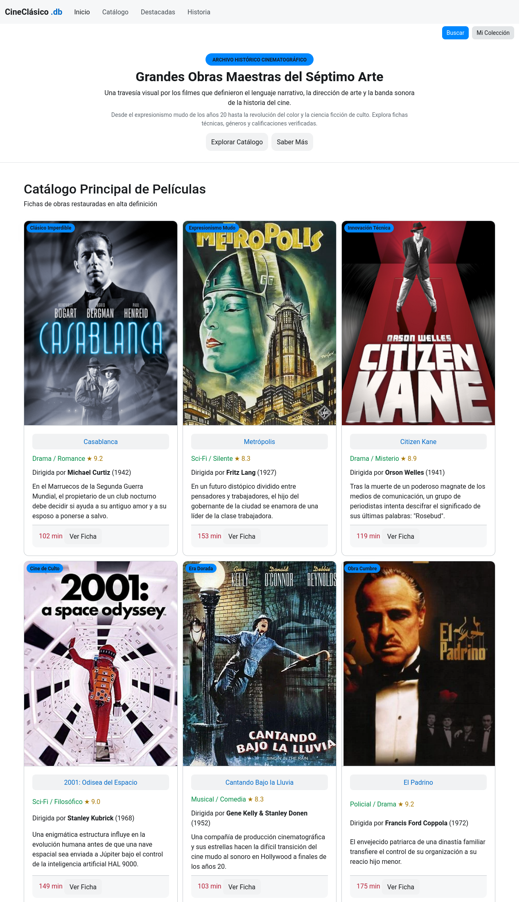

# 🎬 CineClásico.db

Página web estática de un catálogo de películas clásicas, hecha con **HTML** y **Bootstrap**.

🔗 **Ver la página en vivo:** https://TU_USUARIO.github.io/cine-clasico/



## Contenido

Un archivo de grandes obras maestras del séptimo arte, con ficha de cada película (género, calificación, director, año, sinopsis y duración):

- Casablanca (1942)
- Metrópolis (1927)
- Citizen Kane (1941)
- 2001: Odisea del Espacio (1968)
- Cantando Bajo la Lluvia (1952)
- El Padrino (1972)

## Tecnologías

- HTML5
- [Bootstrap](https://getbootstrap.com/) (vía CDN)

## Cómo verla en tu computadora

1. Clona el repositorio:
   ```bash
   git clone https://github.com/TU_USUARIO/cine-clasico.git
   ```
2. Abre `index.html` en tu navegador.
